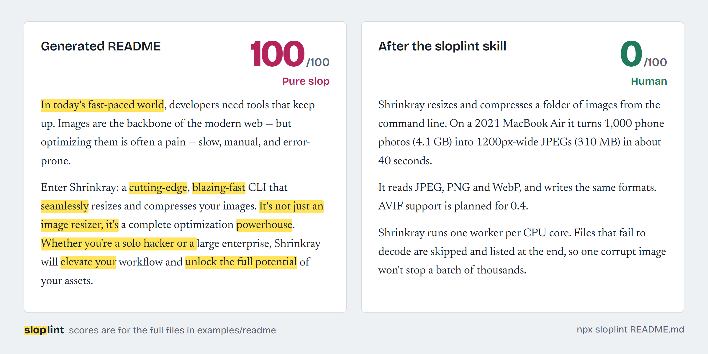

# sloplint

Catch the phrases that make writing read like unedited AI output, before your readers do.



[](https://github.com/kcgdz/sloplint/actions/workflows/ci.yml)
[](https://www.npmjs.com/package/sloplint)
[](#slop-score)

**Try it in the browser:** [kcgdz.github.io/sloplint](https://kcgdz.github.io/sloplint/)

## Before and after

An excerpt from a typical generated README ([full file](examples/readme/before.md)):

> In today's fast-paced world, developers need tools that keep up. Images are the backbone of the modern web — but optimizing them is often a pain — slow, manual, and error-prone.
>
> Enter **Shrinkray**: a **cutting-edge**, **blazing-fast** CLI that **seamlessly** resizes and compresses your images. It's not just an image resizer, it's a complete optimization powerhouse.

The same README after a rewrite with the sloplint skill ([full file](examples/readme/after.md)):

> Shrinkray resizes and compresses a folder of images from the command line. On a 2021 MacBook Air it turns 1,000 phone photos (4.1 GB) into 1200px-wide JPEGs (310 MB) in about 40 seconds.

```console
$ npx sloplint examples/readme/before.md
examples/readme/before.md  slop score 100/100 Pure slop
  ...
  5:1     warning  "In today's fast-paced world"  opener/fast-paced-world
                   A stock opener that delays the point and could precede any text about anything.
                   fix: Delete it and open with the concrete problem or the news.
  ...
  43:1    warning  "In conclusion"  closer/in-conclusion
                   An essay-template closer that announces a summary of what the reader just read.
                   fix: End on the last useful sentence, or a concrete next step.
  ...

54 findings (0 errors, 47 warnings, 7 info) in 1 file, 243 words.
Slop score: 100/100 (Pure slop)

$ npx sloplint examples/readme/after.md
examples/readme/after.md  slop score 0/100 Human
  no findings

No slop found in 1 file (211 words).
Slop score: 0/100 (Human)
```

## Install in 30 seconds

Lint a file, no install needed (Node 22+):

```bash
npx sloplint README.md
```

Teach Claude Code to avoid the patterns while it writes, by adding the plugin from inside Claude Code:

```text
/plugin marketplace add kcgdz/sloplint
/plugin install sloplint@sloplint
```

Or copy the skill folder by hand:

```bash
git clone --depth 1 https://github.com/kcgdz/sloplint
cp -r sloplint/skills/sloplint ~/.claude/skills/
```

The skill loads when Claude writes a README, landing page, post, commit message or email. It reads a type-specific guide only for the kind of text at hand, then checks the draft with the CLI when a shell is available.

## What it checks

<!-- rules:count -->39<!-- /rules:count --> deterministic rules in seven categories: openers, vocabulary, structure, formatting, hedging, closers and leftovers. Each finding has a rule ID, the exact position, the flagged text, the reason it reads as slop, and a suggested fix. Every rule ships with examples it must flag and examples it must leave alone, and both sets run as tests.

sloplint does not call a model and does not need a network connection. It skips code blocks, inline code, blockquotes, URLs, link targets, HTML and frontmatter, so quoting slop to talk about it is fine.

<!-- rules:start -->
<!-- sloplint-disable -->

| Rule | Default | Catches |
| --- | --- | --- |
| `opener/fast-paced-world` | warning | "In today's fast-paced world" |
| `opener/ever-evolving-landscape` | warning | "The ever-evolving landscape" |
| `opener/imagine-a-world` | warning | "Imagine a world where…" |
| `opener/lets-dive-in` | warning | "Let's dive in" |
| `opener/rhetorical-hook` | warning | "Have you ever wondered…?" |
| `opener/chatbot-preamble` | error | "Certainly! Here's…" |
| `opener/hope-finds-you-well` | warning | "I hope this email finds you well" |
| `vocab/delve` | warning | "Delve" |
| `vocab/tapestry` | warning | Ornamental metaphors ("tapestry", "testament") |
| `vocab/hype-adjectives` | warning | Hype adjectives ("seamless", "cutting-edge") |
| `vocab/game-changer` | warning | "Game-changer", "next-level" |
| `vocab/empty-verbs` | warning | Empty verbs ("unlock", "elevate", "empower") |
| `vocab/leverage-utilize` | warning | "Leverage", "utilize", "facilitate" |
| `vocab/journey` | info | "Journey", "embark on" |
| `vocab/gravitas` | info | Gravitas words ("pivotal", "crucial", "meticulous") |
| `vocab/intensifiers` | info | Stacked intensifiers ("truly", "incredibly") |
| `vocab/corporate-speak` | warning | Corporate jargon ("synergy", "actionable insights") |
| `structure/not-just-x` | warning | "It's not just X, it's Y" |
| `structure/rule-of-three` | info | Everything in threes |
| `structure/colon-reveal` | warning | "The result? …" |
| `structure/heres-why` | warning | "Here's why:" |
| `structure/whether-youre` | warning | "Whether you're a beginner or an expert" |
| `structure/one-line-paragraphs` | warning | Run of one-sentence paragraphs |
| `structure/question-endings` | warning | Paragraphs ending in questions |
| `structure/bold-label-bullets` | info | "**Label:** description" bullets |
| `format/em-dash-density` | info | Em-dash overuse |
| `format/emoji-headings` | warning | Emoji in headings |
| `format/emoji-bullets` | warning | Emoji as bullet points |
| `format/excessive-bold` | warning | Too much bold |
| `format/exclamation-overuse` | warning | Exclamation marks |
| `format/hashtag-stuffing` | warning | Hashtag stuffing |
| `hedge/stacked` | warning | Stacked hedges ("may potentially") |
| `hedge/worth-noting` | warning | "It's worth noting that" |
| `hedge/qualifier-density` | info | Qualifier pile-up |
| `closer/in-conclusion` | warning | "In conclusion" |
| `closer/engagement-bait` | warning | "What do you think? Let me know in the comments" |
| `closer/hope-this-helps` | warning | "Hope this helps! Feel free to reach out" |
| `closer/future-is-bright` | warning | "The future is bright" |
| `filler/ai-self-reference` | error | Leftover assistant text and placeholders |

<!-- sloplint-enable -->
<!-- rules:end -->

Rules marked `info` are density checks: they fire only when a pattern is frequent, since one em-dash or one triplet is ordinary writing. The full catalog with examples is in [patterns.md](skills/sloplint/references/patterns.md).

## Usage

```bash
sloplint README.md docs/              # files and directories (.md, .mdx, .markdown, .txt)
sloplint "content/**/*.md"            # globs
git log -1 --format=%B | sloplint     # stdin
sloplint README.md --json             # machine-readable output
sloplint README.md --format github    # GitHub Actions annotations
sloplint README.md --badge            # print a shields.io badge for the score
sloplint --list-rules
```

| Option | Effect |
| --- | --- |
| `-f, --format <name>` | `stylish` (default), `json` or `github` |
| `-c, --config <path>` | Use this config file; `--no-config` ignores config files |
| `--rule <id=level>` | Override a rule for this run, e.g. `--rule vocab/delve=off` |
| `--max-score <n>` | Exit 1 if any file scores above `n` |
| `--fail-on <level>` | Exit 1 on findings at this level or above. Default `error` |
| `--skip-quoted` | Don't lint text inside double quotes |
| `-q, --quiet` | Hide `info` findings (they still count toward the score) |

Exit codes: `0` passed, `1` over a threshold, `2` usage or config error.

### In CI

```yaml
# .github/workflows/prose.yml
name: prose
on: [pull_request]
jobs:
  sloplint:
    runs-on: ubuntu-latest
    steps:
      - uses: actions/checkout@v4
      - uses: actions/setup-node@v4
        with:
          node-version: 22
      - run: npx sloplint README.md docs --format github --max-score 30
```

Findings show up as annotations on the pull request diff.

## Configuration

sloplint looks for `.sloplintrc` or `.sloplintrc.json` in the current directory and its parents, or a `sloplint` key in `package.json`.

```json
{
  "rules": {
    "format/em-dash-density": "off",
    "vocab/hype-adjectives": ["warning", { "allow": ["robust"] }],
    "vocab/gravitas": ["info", { "minCount": 5, "per100Words": 2 }],
    "closer/*": "error"
  },
  "ignore": ["CHANGELOG.md", "vendor/**"],
  "maxScore": 30,
  "failOn": "warning"
}
```

A rule setting is `"off"`, `"info"`, `"warning"`, `"error"`, or a pair of level and options. Keys can be a rule ID, `category/*`, or a bare category. Phrase rules accept `allow`; density rules accept `minCount` and `per100Words`.

### Ignoring a line

Directives work in any comment syntax, so they also fit commit message templates and code comments.

```markdown
<!-- sloplint-disable-next-line vocab/journey -->
Journey is the name of our onboarding app.

<!-- sloplint-disable format/em-dash-density -- a quoted transcript -->
...
<!-- sloplint-enable -->

<!-- sloplint-disable-file -->
```

IDs can be rule IDs or categories. With no IDs, a directive applies to every rule. Text after ` -- ` is a note for humans.

## Slop score

Every file gets a score from 0 (clean) to 100. Findings add points by severity (error 5, warning 3, info 1), the total is divided by the word count, and the density is mapped onto a curve:

```text
density = points / max(words, 50) × 100
score   = round(100 × (1 − e^(−density / 10)))
```

Length is normalized, so a long document isn't punished for being long and a one-line commit message isn't maxed out by a single phrase. The bands:

| Score | Label |
| --- | --- |
| 0 to 14 | Human |
| 15 to 39 | Light seasoning |
| 40 to 69 | Sloppy |
| 70 to 100 | Pure slop |

`sloplint --badge` prints a badge you can paste into your README, like the one at the top of this file.

## Examples

Five generated texts and their rewrites live in [`examples/`](examples). CI checks that every "before" scores at least 70 and every "after" scores under 15 with no warnings.

| Text | Before | After |
| --- | --- | --- |
| [README](examples/readme) | 100 | 0 |
| [Landing page](examples/landing-page) | 99 | 0 |
| [LinkedIn post](examples/linkedin-post) | 97 | 0 |
| [Tweet thread](examples/tweet-thread) | 99 | 0 |
| [Cold email](examples/cold-email) | 99 | 0 |

## Programmatic use

```ts
import { lint } from 'sloplint';

const { score, label, findings } = lint(text, {
  rules: { 'vocab/delve': 'error' },
});
```

The core has no Node dependencies and runs in the browser; the [playground](https://kcgdz.github.io/sloplint/) uses the same engine.

## Contributing

New patterns are the most useful contribution. If you keep seeing a phrase in generated text, [open a pattern proposal](https://github.com/kcgdz/sloplint/issues/new?template=new-slop-pattern.yml) with a few real examples and a few look-alikes that should not be flagged. False-positive reports matter just as much: a linter people turn off helps nobody.

[CONTRIBUTING.md](CONTRIBUTING.md) walks through adding a rule, from the metadata to the tests.

## License

MIT
